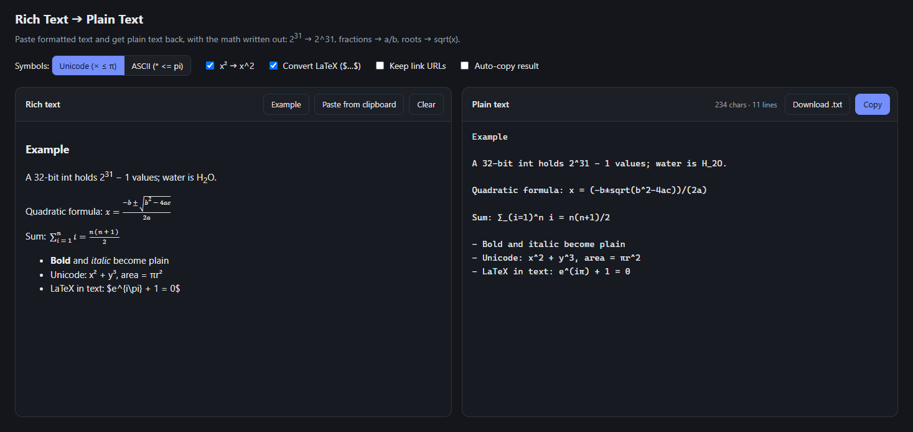

# Rich Text 🡒 Plain Text



Paste formatted text and get plain text back, with math and formatting written out as normal characters.

| Rich text | Plain text |
|---|---|
| 2<sup>31</sup> | `2^31` |
| H<sub>2</sub>O | `H_2O` |
| a fraction (a+b over c) | `(a+b)/c` |
| square root of x + 1 | `sqrt(x + 1)` |
| cube root of x | `x^(1/3)` |
| sum from i=1 to n | `∑_(i=1)^n` (ASCII mode: `sum_(i=1)^n`) |
| x², 10⁻³ | `x^2`, `10^-3` |
| `$e^{i\pi}$` (LaTeX) | `e^(iπ)` |
| bold / italic / headings | plain text |
| bullet and numbered lists | `- item`, `1. item` |
| tables | tab-separated rows |

## Installation

No installation needed. Get the files with either option:

**Option 1 - Download ZIP:** click **Code 🡒 Download ZIP** on GitHub, then unzip it.
**Option 2 - Git:** `git clone https://github.com/<your-username>/rich-text-to-plain-text.git`

Only `index.html` and `converter.js` are needed; keep them in the same folder. No internet connection is needed after downloading.

## Usage

Open `index.html` in a browser (double-click it).

1. Copy something from Word, Google Docs, ChatGPT, Wikipedia, a web page, etc.
2. Click the left box and press **Ctrl+V**.
3. Click **Copy** to copy the plain text, or **Download .txt** to save it.

Options:
- **Symbols:** *Unicode* keeps symbols like `×`, `≤`, `π`. *ASCII* turns them into `*`, `<=`, `pi`.
- **x² 🡒 x^2:** converts Unicode superscript and subscript characters.
- **Convert LaTeX ($…$):** converts `$…$`, `$$…$$`, `\(…\)` and `\[…\]` found in the text.
- **Keep link URLs:** writes links as `text (https://…)`.
- **Auto-copy result:** copies the output to the clipboard right after each paste.

## Supported sources

- HTML formatting: `<sup>`, `<sub>`, `vertical-align: super/sub` (Google Docs), lists, tables, headings, line breaks
- MathML (Wikipedia, Office, and many websites)
- KaTeX (ChatGPT, Notion and many other sites) and MathJax 2/3
- Microsoft Word equations (OMML in the clipboard HTML)
- LaTeX: fractions, roots, sums, integrals, limits, matrices, `cases`, `aligned`, accents, Greek letters, `\text{…}` and more
- Unicode math letters (𝑥 🡒 x), superscripts and subscripts

## Use from code

`converter.js` has no dependencies and works in any browser:

```html
<script src="converter.js"></script>
<script>
  RichToPlain.htmlToPlain('2<sup>31</sup>');        // "2^31"
  RichToPlain.latexToText('\\frac{1}{2}');          // "1/2"
  RichToPlain.textToPlain('x² + y²', { ascii: true }); // "x^2 + y^2"
</script>
```

Options: `{ ascii, unicodeScripts, latexInText, keepLinks }`.

## Tests

Only needed if you want to run the tests. Requires [Node.js](https://nodejs.org/).

```
npm install
npm test
```

`npm install` downloads jsdom, which the tests use to run the converter outside a browser. The app itself has no dependencies.
